<!--
  Profile README for github.com/Niklas-dev
  The banners under assets/ are hand-built SVGs, generated by tools/build_assets.py.
  Preview locally the way GitHub renders it:  python tools/preview.py
-->

<a href="https://github.com/Niklas-dev"></a>


I work where software engineering, cybersecurity and AI meet: AI infrastructure and GPU compute, event-driven microservices, and systems designed to scale and be measured, down to the kernel when it has to be. At <b>ZeroSubnet</b> that means security software and platform engineering: Python microservices behind a high-throughput reporting platform, event-driven over NATS, running on Kubernetes. Alongside, a dual B.Sc. in Computer Science (Cyber Security) with <b>IBM</b>. The rest of the time it is open-source tooling, Kaggle, side products, and a YouTube channel about backend development.


<a href="https://github.com/Niklas-dev/tessera">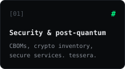</a>
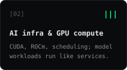
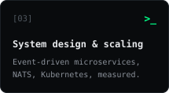
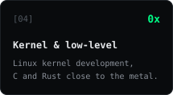
<a href="https://github.com/Niklas-dev/look-and-mark">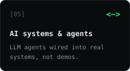</a>
<a href="https://www.kaggle.com/niklasdev">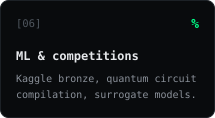</a>
<a href="https://github.com/Niklas-dev/ungdc-drift">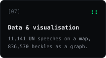</a>
<a href="https://fastlaunchapi.dev">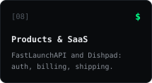</a>
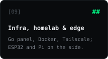


<a href="https://github.com/Niklas-dev/tessera"></a>


<a href="https://www.kaggle.com/niklasdev"></a>
<a href="https://fastlaunchapi.dev"></a>

<a href="https://github.com/Niklas-dev/ungdc-drift"></a>
<a href="https://github.com/Niklas-dev/bundestag-heckling-network"></a>

<a href="https://github.com/Niklas-dev/look-and-mark"></a>


| Project | What it is | Stack | Status |
|:--|:--|:--|:--|
| [**Dishpad**](https://dishpad.app) | Restaurant management: digital QR menus, reservations and orders. A Turborepo monorepo with end-to-end type safety from database to UI. | Next.js 15 · Fastify · tRPC · Drizzle · Better Auth | live |
| **Quantum circuit compilation** | Kaggle competition by Google Quantum AI on verifiable quantum circuit compilation. Team entry, running until January 2027. | Python | in progress |
| **LLM World** | A low-poly 3D town where every resident is an LLM agent with memory, tools and turn-taking conversations. The town keeps living between sessions. | React Three Fiber · Node · LLM agents | unpublished |
| **Spillpoint** | From a raw seismic survey to a drill or do-not-drill call on the Norwegian Continental Shelf, ten model phases, entirely on free public data. | Python · geoscience ML | unpublished |
| **License plate tracker** | Realtime ALPR on a Raspberry Pi 4: detection, OCR normalisation, fuzzy de-duplication, live MJPEG view and stats. | Python · OpenCV | private |
| **Roblox games** | Each game is its own repo with Rojo, typed Luau and a server-authoritative design, built from one shared template. | Luau · Rojo | private |


 

 

 

 

 


Backend tutorials and project walkthroughs, mostly FastAPI. The two FastLaunchAPI videos have passed a million views between them; the rest are the fifteen-minute answers I wish I had found myself. Companion repos, written to be read as much as run:

| Repo | Topic |
|:--|:--|
| [`fastapi-quick-template`](https://github.com/Niklas-dev/fastapi-quick-template) | Lean FastAPI starter with JWT auth, PostgreSQL and Alembic. My most-starred repo. |
| [`sqlalchemy-async-vs-sync`](https://github.com/Niklas-dev/sqlalchemy-async-vs-sync) | Measuring async against sync SQLAlchemy instead of guessing |
| [`fastapi-elasticsearch-blog`](https://github.com/Niklas-dev/fastapi-elasticsearch-blog) | Full-text search with Elasticsearch |
| [`fastapi-lifespan-tutorial`](https://github.com/Niklas-dev/fastapi-lifespan-tutorial) | Lifespan events and clean startup and shutdown |
| [`create-nextjs-fastify-trpc-app`](https://github.com/Niklas-dev/create-nextjs-fastify-trpc-app) | Scaffolding a typed full-stack app in one command |


<picture>
  <source media="(prefers-color-scheme: dark)" srcset="https://raw.githubusercontent.com/Niklas-dev/Niklas-dev/output/pacman-contribution-graph-dark.svg">
  <source media="(prefers-color-scheme: light)" srcset="https://raw.githubusercontent.com/Niklas-dev/Niklas-dev/output/pacman-contribution-graph.svg">
  
</picture>

Most of my commits land in private repos (work, studio, products), so the public graph is the visible slice.


Open to collaborations on security tooling, AI systems and the occasional freelance build. Email is the fastest way to reach me.


 
Contribution game by <a href="https://github.com/abozanona/pacman-contribution-graph">pacman-contribution-graph</a>, streak by <a href="https://github.com/DenverCoder1/github-readme-streak-stats">github-readme-streak-stats</a>, badges by <a href="https://shields.io">shields.io</a>. Everything else is hand-made SVG in this repo.

